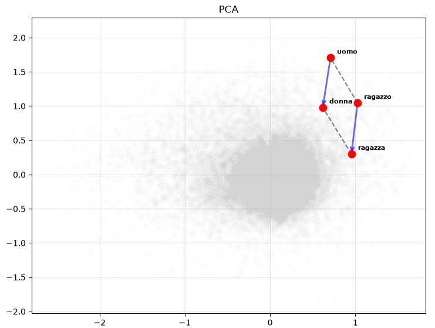
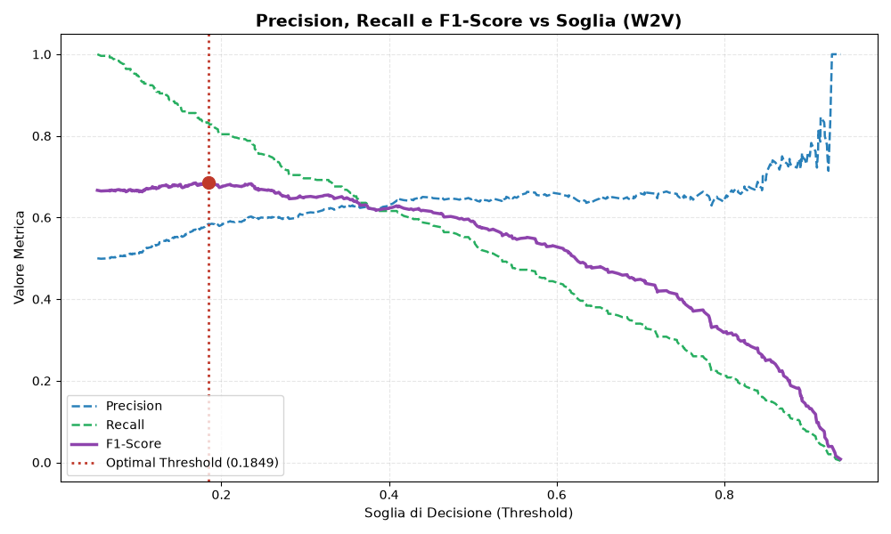
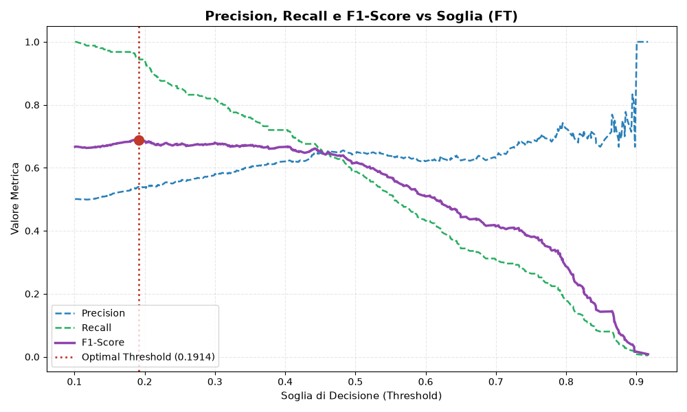
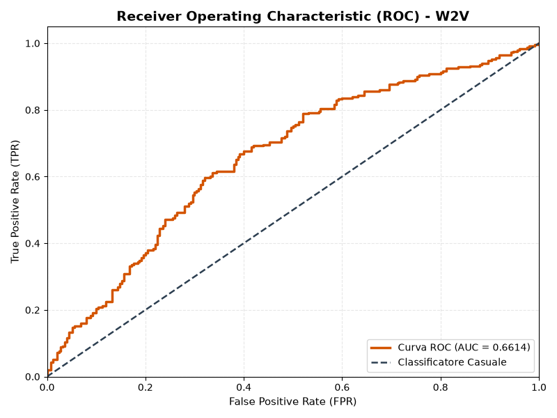
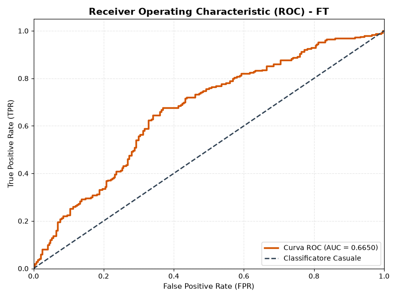

# Natural Language Processing @ UNIPA

This repository contains the implementation for **Assignment 03** of the **Natural Language Processing** course. It is part of the Master’s Degree in **Computer Engineering** at the **University of Palermo**.

---

## Course Information
* **Instructor:** Prof. Roberto Pirrone
* **Academic Year:** 2026/2027
* **Task Reference:** [EVALITA 2023 - WiC-ITA](https://wic-ita.github.io/) (*Word-in-Context for Italian*, Subtask 1)
* **Topic:** Lexical Semantics & Word Sense Disambiguation (WSD) via WordNet, Word2Vec, and FastText

---

## Overview

The goal of this assignment is binary Word Sense Disambiguation on the **WiC-ITA** dataset. Given a target `lemma` and two sentences (`sentence1`, `sentence2`), the model predicts whether the lemma has the same meaning (`1`) or not (`0`).

The pipeline consists of three steps:
1. **Baseline:** A simple WordNet heuristic that matches sentences to synset definitions via Jaccard similarity.
2. **Embeddings:** Domain-specific **Word2Vec** and **FastText** models trained on sentences, definitions, and related lemmas.
3. **Classifier:** A lightweight neural classifier trained on sentence and lemma embeddings, with threshold tuning to handle class imbalance.

> For a detailed explanation of the implementation choices, see [NOTES.md](NOTES.md).

---

## Experimental Analysis & Results

### 1. Semantic Parallelogram (PCA)
To check if the embeddings capture gender offsets, I verify the analogical relationship:
`v(uomo) - v(donna) ≈ v(ragazzo) - v(ragazza)`
*(man - woman ≈ boy - girl)*

Projecting Word2Vec vectors onto 2D with PCA preserves this parallelogram clearly:

<p align="center">
  
</p>

* The transition vectors `uomo → donna` (*man → woman*) and `ragazzo → ragazza` (*boy → girl*) have almost the exact same direction and length.
* The grey background points show that both pairs sit naturally inside the general semantic manifold.

---

### 2. Threshold Calibration
Because the dataset has class imbalance, the standard `0.5` decision cutoff is suboptimal. I sweep thresholds on validation to maximize F1:

| Word2Vec (Best threshold = 0.1849) | FastText (Best threshold = 0.1914) |
| :---: | :---: |
|  |  |

* Calibrated threshold: **0.1849** for Word2Vec (validation F1 = **0.6865**) and **0.1914** for FastText (validation F1 = **0.6889**).

---

### 3. Classification Results

ROC curves on validation:

| Word2Vec (AUC = 0.6614) | FastText (AUC = 0.6650) |
| :---: | :---: |
|  |  |

#### Validation Set

| Model | Representation | Optimal Threshold | ROC-AUC | F1-Score |
| :--- | :--- | :---: | :---: | :---: |
| **WordNet Baseline** | Jaccard Overlap on Synsets | N/A | — | 0.4132 |
| **Word2Vec + MLP** | Skip-Gram (150-D) + Mean Pooling | 0.1849 | 0.6614 | 0.6865 |
| **FastText + MLP** | Skip-Gram Subwords (150-D) + Mean Pooling | 0.1914 | 0.6650 | 0.6889 |

#### Test Set

| Model | Threshold | ROC-AUC | F1-Score | Precision | Recall |
| :--- | :---: | :---: | :---: | :---: | :---: |
| **WordNet Baseline** | N/A | — | 0.4670 | 0.5196 | 0.4240 |
| **Word2Vec + MLP** | 0.1849 | 0.5568 | 0.6090 | 0.5214 | 0.7320 |
| **FastText + MLP** | **0.1914** | **0.5642** | **0.6686** | **0.5264** | **0.9160** |

* Key takeaway: FastText subwords handle unseen test vocabulary much better, reaching **0.6686** test F1 with very high recall (**0.9160**).
* For comparison, top EVALITA 2023 WiC-ITA systems reach ~0.73 F1 using large pre-trained language models; my simple Skip-Gram + MLP pipeline reaches **0.6686** F1 with no heavy pre-trained transformers.

---

## Directory Structure

```
main_dir:
|
|--DATASET/ (folder, optional if in root)
|    |--train.parquet
|    |--validation.parquet
|    |--test.parquet
|
|--checkpoints/ (folder created automatically)
|    |--best_model_bundle.pt
|    |--train_dataset_w2v.npz
|    |--train_dataset_ft.npz
|    |--...
|
|--images/
|    |--parallelogram_pca.png
|    |--f1_threshold_w2v_clean.png
|    |--f1_threshold_fft_clean.png
|    |--auc_roc_w2v_clean.png
|    |--auc_roc_fft_clean.png
|
|--plots_submission3.py
|--submission3.py
|--README.md
|--.gitignore
```

---

## Setup & Requirements

1. **Python Environment:** Ensure Python 3.10+ is installed.
2. **Install Dependencies:**
   ```bash
   pip install torch spacy gensim nltk wn pandas numpy scikit-learn umap-learn matplotlib emoji num2words fastparquet
   ```
3. **Download Linguistic Resources:**
   ```bash
   python -m spacy download it_core_news_md
   python -c "import wn; wn.download('omw-it:1.4')"
   ```

---

## User Guide

The script `submission3.py` is organized into independent modular phases controlled by boolean flags in the `if __name__ == "__main__":` block. Visualization functions are decoupled and maintained inside `plots_submission3.py`.

### Execution Flags

Inside `submission3.py`, toggle the desired pipeline steps:

* **`eval_baseline = True`**: Computes the symbolic baseline on `train`, `validation`, and `test` splits using WordNet synsets and Jaccard similarity.
* **`build_embeddings = True`**: Extracts sentences, definitions, and associated lemmas to build the extended corpus, then trains Word2Vec and FastText models.
* **`plot_subspace = True`**: Computes 2D projections (PCA, t-SNE, UMAP) and generates semantic parallelogram plots for analogical concept quadruplets.
* **`create_datasets = True`**: Encodes sentences and lemmas into L2-normalized feature vectors and saves compressed `.npz` datasets.
* **`training = True`**: Trains the MLP neural network across models (`w2v` and `ft`), plotting loss convergence, ROC curves, and optimal decision threshold calibration.
* **`model_selection = True`**: Selects the best performing model on the test set and serializes the complete bundle (`state_dict`, threshold, and metrics) into `checkpoints/best_model_bundle.pt`.

### Running the Pipeline

Simply run the main script from your terminal:

```bash
python submission3.py
```